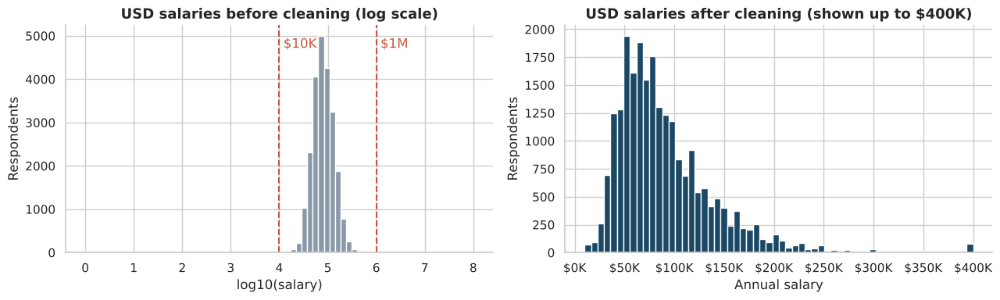
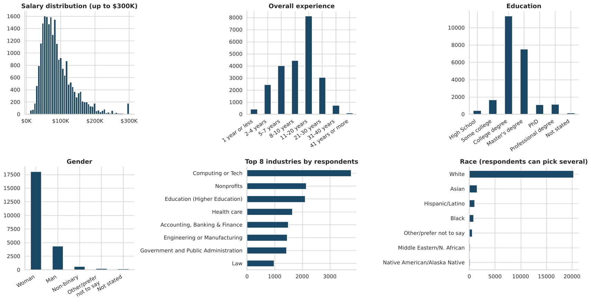
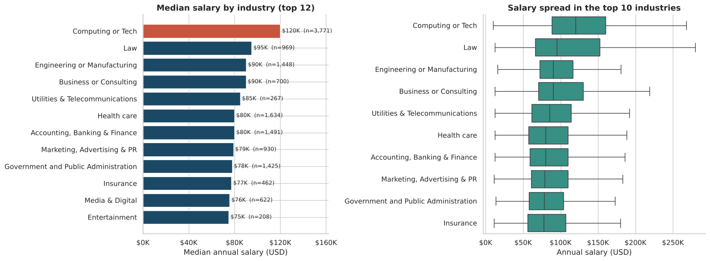
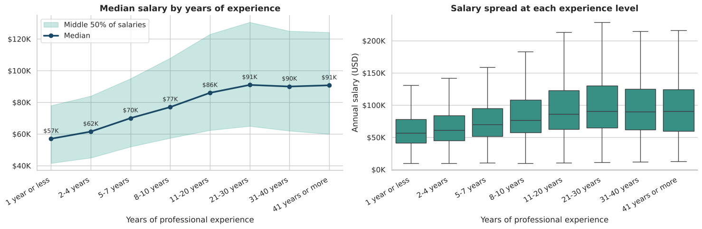
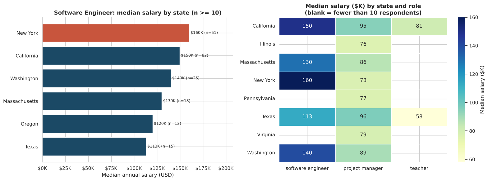
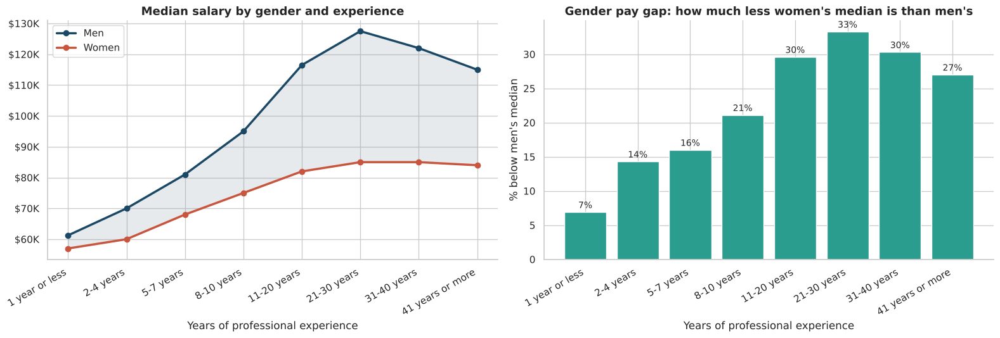
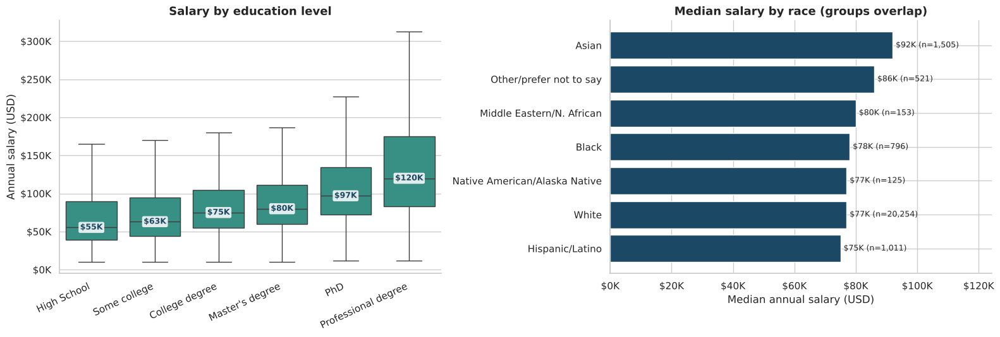
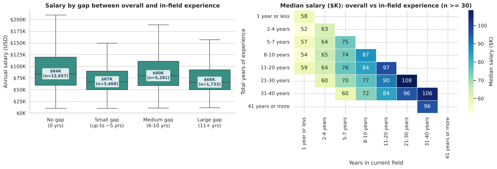

# What Determines Pay? Ask A Manager Salary Survey Analysis

> An exploratory data analysis of 28,225 crowd-sourced salary responses in Python. After cleaning messy salary, country, currency and experience data, I answered six questions about pay and found that **industry, years in the current field, education and location** matter most.

---

## 1. Introduction

Salary data is easy to collect and hard to trust. This project uses the **Ask A Manager Salary Survey**, an open survey where people report their pay, job, industry, location, experience, education, gender and race. Because anyone could type anything into the form, the data is messy: salaries stored as text, the same country spelled dozens of ways, many currencies and some impossible values.

I cleaned the data into an analysis-ready state and used it to answer six business-style questions about what relates to pay. This was completed as a capstone project for the Digitalley Drive Data Science Track.

---

## 2. Problem Statement

What determines pay? Which factors are linked to higher or lower salaries, and by how much?

**The six questions:**
1. Which industry pays the most?
2. How does salary increase with years of experience?
3. How do salaries compare for the same role in different locations?
4. How much do salaries differ by gender and years of experience?
5. How do education level and race relate to salary?
6. Is there a "sweet spot" between total work experience and years in the specific field?

---

## 3. Data Sourcing

- **Dataset:** Ask A Manager Salary Survey 2021, **28,225 responses and 18 columns**. One row is one respondent.
- **Source:** [add the link or where you got the file, e.g. the Digitalley Drive project brief]
- **Collected by:** an open online survey shared through the Ask A Manager blog.
- **Key columns:** age bracket, industry, job title, annual salary, additional compensation, currency, country, state, city, years of experience (overall and in the field), education, gender and race.

---

## 4. Tools I Used and Why

| Tool | What I used it for |
|---|---|
| **Python (Google Colab)** | The whole workflow, in one notebook that can be re-run and reviewed |
| **pandas and NumPy** | Cleaning text, converting types, grouping and summarising 28,000 rows |
| **matplotlib and seaborn** | Bar charts, line charts, box plots and heatmaps |

I chose Python because the cleaning (country spellings, experience ranges, multi-select race) needs rules that are hard to do reliably in a spreadsheet, and a notebook lets a reviewer see every decision next to its result. No dashboard was needed. The questions are answered with charts inside the notebook.

---

## 5. Data Transformation and Cleaning

Cleaning was a major part of this project. The decisions are documented in the notebook, with the reasons.

| Issue | What I did |
|---|---|
| **Long column names** (whole survey questions) | Renamed all 18 columns to short names such as `Salary`, `Industry` and `Overall Experience` |
| **Salary stored as text** | Converted salary and additional compensation to numbers |
| **Inconsistent countries** (329 spellings) | Standardised to 216 values, for example USA, US and United States of America became "United States", and England and Scotland became "United Kingdom" |
| **Mixed currencies** | Kept **USD responses only** (23,497 rows, 83%). Converting with approximate rates would add errors of its own |
| **Experience as text ranges** with inconsistent spacing ("2 - 4 years" vs "5-7 years") | Fixed the spacing, put the ranges in order, and added a numeric midpoint for each |
| **Race is multi-select** (several answers in one cell) | Created one yes/no column per race category. About 6.6% of respondents chose more than one, so groups overlap |
| **Missing values** | Optional text columns left untouched. Missing education and gender labelled "Not stated" |
| **Duplicate rows** | Checked and found none |
| **Outliers** | Removed salaries below 10,000 USD or above 1,000,000 USD (**145 rows**). Values such as 0 or 100 million are entry errors that distort averages |

After cleaning, **23,352 respondents** remain. The median salary is **78,500 USD** and the mean is 91,380 USD. **Medians are used throughout** because they are not distorted by extreme values.

**Note on the survey period:** the survey form stayed open after 2021, so about 600 responses carry later dates. They are the same survey and are kept by default. A setting in the notebook (`RESTRICT_TO_2021`) limits the analysis to 2021 only.

---

## 6. Analytics and Measures

- **Median, mean and respondent counts (n)** by industry, experience, state, gender, education and race. Every result shows its sample size.
- **Pay gap:** (men's median minus women's median) divided by men's median, at each experience level.
- **Experience Gap** (derived feature): overall experience minus years in the current field, using range midpoints.
- **Spearman correlation** of salary with total experience, years in the field and the gap.
- **Minimum sample sizes:** at least 100 respondents per industry, at least 10 per state and role, and at least 30 per heatmap cell, so no conclusion rests on a handful of people.

---

## 7. Charts and Findings

### Overview of the cleaned data

The sample is 77% women, about 87% selected White, and most respondents are college or Master's graduates with 8 to 20 years of experience. This is a self-selected sample, so results describe the survey and not every worker.

### Q1. Which industry pays the most?

**Computing or Tech**, with a median of **120,000 USD**, about 50% above the overall median. Law is next at 95,000 USD. Most other industries fall between 75,000 and 85,000 USD.

### Q2. How does salary grow with experience?

The median rises about **60%**, from 57,000 USD (1 year or less) to 91,000 USD (21 to 30 years), then **flattens at about 90,000 USD**. The spread also widens, so experience lifts the top of the range more than the bottom.

### Q3. Same role, different locations

For software engineers, **New York (160,000 USD) pays about 42% more than Texas (113,000 USD)**. The best state depends on the role: for project managers, Texas and California lead and New York is near the bottom. Samples for some states are small (12 to 82 respondents) and figures are not adjusted for cost of living.

### Q4. Gender and experience

Women's median salary is **25% lower** than men's overall (75,000 vs 100,000 USD). The gap is about 7% in the first year and **grows to about 33%** at 21 to 30 years of experience. This compares medians without controlling for industry or job level, so it shows that a gap exists, not why.

### Q5. Education and race

- **Education:** pay rises at every level, from 55,000 USD (High School) to 75,000 (College), 80,000 (Master's), 97,000 (PhD) and **120,000 (Professional degree)**.
- **Race:** Asian respondents have the highest median (92,000 USD, about 20% above White respondents), and this holds within each education level. Black, Hispanic/Latino, White and Native American respondents are within about 3,000 USD of each other.

### Q6. The experience "sweet spot"

People whose whole career is in their current field earn the most (**84,000 USD**). With a small gap the median is 67,000 USD, and with 11 or more years outside the field it is 66,000 USD. For the same total experience, more years in the field means higher pay. For the same years in the field, more total experience means lower pay.

---

## 8. Recommendation

1. **For job seekers and career planners:** build depth in one field. Years in the current field are worth more in pay than years spent elsewhere, and career changers should expect to start lower.
2. **Consider the industry and role:** Tech and Law pay the most, and advanced or professional degrees show the biggest pay increase.
3. **For employers and HR:** review pay by experience level. The gender gap widens with seniority, so mid-career and senior pay bands deserve the closest check.
4. **Compare location by role:** a high-paying state for one job is not necessarily high-paying for another.
5. **For future analysis:** collect job level, hours and company size. They would help explain gaps that this dataset can only describe.

---

## 9. Conclusions

- **Industry, experience in the field, education and location are all linked to pay.** Tech pays about 50% above the overall median.
- **Experience pays off early and then levels off** at about 90,000 USD after 21 years.
- **The gender pay gap grows with seniority**, from about 7% to about 33%.
- **Staying in one field pays more** than the same number of years spread across fields.
- **Data cleaning shaped the results.** Without removing impossible salaries, one industry showed an average of about 470,000 USD against a median of about 85,000 USD.
- **Limitations:** self-reported and self-selected data; USD respondents only; patterns are associations and not proof of cause.

---

*Prepared by Nwogbe Onyinyechi Victoria · Data Analyst*
